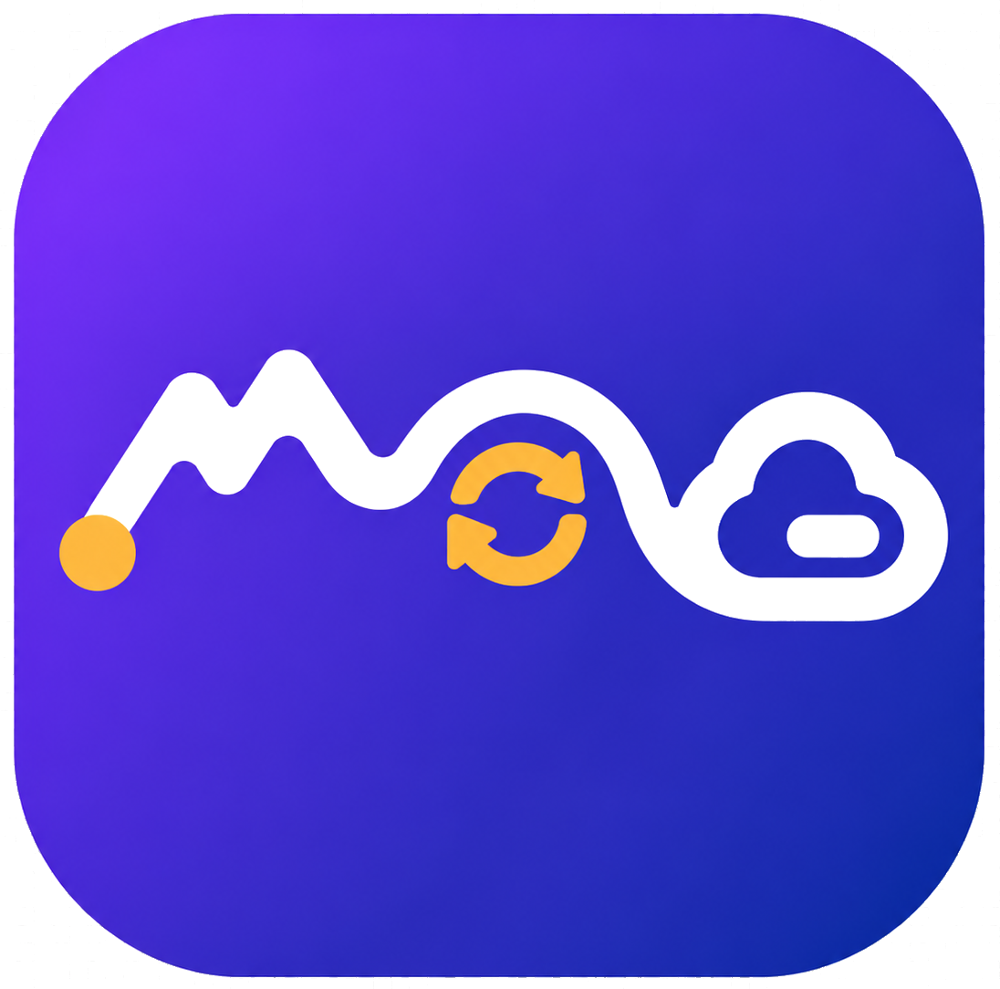
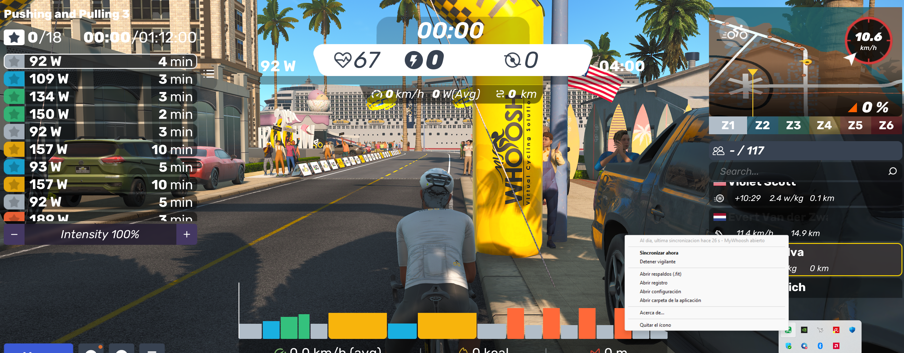

  

# MWGC-Sync

Sincroniza automáticamente tus actividades de MyWhoosh con Garmin Connect, sin subir cada actividad (.fit) a mano.

## Qué hace

- Detecta cuando terminas un viaje en MyWhoosh (o cuando cierras la aplicación) y sube la actividad a Garmin Connect.
- Evita duplicados: si Garmin ya tiene esa actividad, no la vuelve a subir.
- Guarda una copia de respaldo de cada `.fit` procesado.
- Muestra un icono en la bandeja del sistema con el estado (al día, sincronizando, error, detenido) y avisos de Windows cuando sube una actividad.
- Arranca solo al iniciar sesión en Windows.

Es un proyecto personal, sin relación con Garmin ni con MyWhoosh. El acceso a Garmin Connect no es oficial y puede dejar de funcionar sin aviso.

## Motivación

MyWhoosh no ofrece una integración nativa con Garmin Connect. Esto no es una limitación técnica de Garmin: Garmin expone desde hace años una API para que aplicaciones de terceros (Zwift, TrainerRoad, Wahoo, etc.) suban actividades directamente a Garmin Connect, y muchas plataformas de ciclismo indoor ya la usan. La pieza que falta es del lado de MyWhoosh, que hasta ahora no ha construido ni mantenido esa conexión.

Mientras tanto, MyWhoosh sí permite descargar el archivo `.fit` de cada actividad desde su sitio web, y ese archivo se puede subir a mano a Garmin Connect. Es una solución funcional, pero tiene dos problemas en la práctica:

- Hay que hacerlo actividad por actividad, entrando al sitio de MyWhoosh, descargando el archivo y subiéndolo manualmente.
- Según reportan varios usuarios, la importación manual a veces no conserva bien todos los campos (por ejemplo, promedios de potencia o cadencia).

MWGC-Sync automatiza esa subida manual: detecta el archivo `.fit` nuevo apenas MyWhoosh termina de escribirlo y lo sube a Garmin Connect por ti, sin que tengas que entrar a ningún sitio web.

## Capturas

**Icono en la bandeja del sistema:**

## Requisitos

- Windows 11.
- MyWhoosh instalado desde la Microsoft Store (probado con la versión 6.2.0).
- Una cuenta de Garmin Connect.

## Descarga e instalación

1. Ve a la sección [Releases](https://github.com/mhsilvav/mwgc-sync/releases) y descarga el `.zip` de la última versión.
2. Descomprime el archivo en una carpeta fija, por ejemplo `C:\Programas\MWGC-Sync` (no lo ejecutes desde dentro del `.zip`, y no muevas la carpeta después).
3. Haz doble clic en `1-iniciar-sesion.bat`. Te pedirá tu correo y contraseña de Garmin, y el código de verificación en dos pasos si lo tienes activado. La contraseña no se guarda; solo se guarda la sesión, en tu carpeta de usuario.
4. Haz doble clic en `2-activar-inicio-automatico.bat`. Esto deja el programa corriendo cada vez que inicias sesión en Windows, con un icono junto al reloj.

Si Windows muestra "SmartScreen protegió tu equipo", es porque el programa no está firmado digitalmente. Elige "Más información" y luego "Ejecutar de todas formas".

## Uso diario

No tienes que hacer nada más. Haz tu viaje en MyWhoosh y unos segundos después de terminarlo (o al cerrar MyWhoosh), la actividad aparece en Garmin Connect y Windows te muestra un aviso.

El icono junto al reloj indica el estado:

| Icono | Significado                                        |
| ----- | -------------------------------------------------- |
| Verde | Al día                                             |
| Azul  | Sincronizando                                      |
| Rojo  | Error (revisa que tu sesión de Garmin siga activa) |
| Gris  | Detenido                                           |

Con clic derecho sobre el icono puedes sincronizar al instante, abrir la carpeta de respaldos o el registro, y ver "Acerca de...".

## Dónde quedan tus datos

Todo se guarda en tu carpeta de usuario, en `%APPDATA%\mwgc_sync\`: la configuración, el registro, la sesión de Garmin y una copia de cada actividad subida.

## Desinstalar

Haz doble clic en `desinstalar.bat` y luego borra la carpeta del programa. Si también quieres borrar tus datos, elimina `%APPDATA%\mwgc_sync\`.

## Aviso

Por ahora este repositorio solo distribuye el ejecutable. El código fuente podría publicarse más adelante.

Garmin, Garmin Connect y MyWhoosh son marcas de sus respectivos dueños. Este proyecto no tiene relación oficial con ninguno de los dos. Úsalo bajo tu propia responsabilidad.

## Autor

Desarrollado por **[Mariano Silva](https://www.linkedin.com/in/masilvav)** (Santiago, Chile).

## Licencia

Copyright © 2026 Mariano Silva. Todos los derechos reservados.

Este software se distribuye únicamente como ejecutable compilado, para uso personal del autor y de las personas a quienes él se lo entregue directamente. No está permitido redistribuirlo, modificarlo ni utilizarlo con fines comerciales sin autorización expresa del autor. Se entrega "tal cual" (as-is), sin garantía de ningún tipo.
